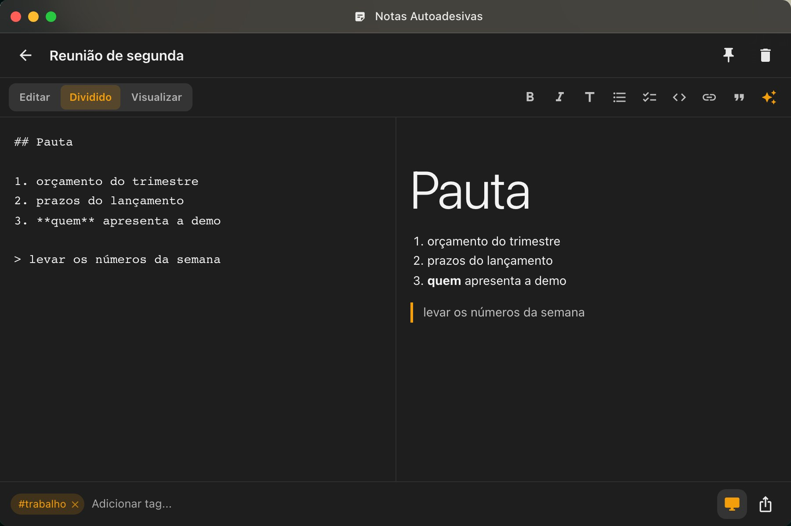
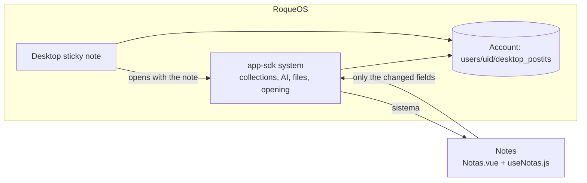

# Notes

_[Português](README.pt-BR.md) | English_

The Notes app of [RoqueOS](https://roqueos.com.br): Markdown notes with edit, preview and split modes, tags, pinning, search, list or grid, export as `.md` or `.txt`, save to Files, and AI over the text. Every note is also a **desktop sticky note**: the same note shows on the RoqueOS desktop, and a change in one place shows in the other. In all ten RoqueOS languages.

Free to use at [roqueos.com.br](https://roqueos.com.br), on the computer, the phone and the TV.



## Why it is its own repository

Notes was born inside RoqueOS, which is closed. On 27/09/2026 it moved to its own repository in the [roqueos-apps](https://github.com/roqueos-apps) organization, the first app to keep data in the account, use AI and be opened by another part of the system. RoqueOS installs it by tag, as a git dependency, and it talks to RoqueOS only through the [`app-sdk`](https://github.com/roqueos-apps/app-sdk). The screen is built with the [`ui`](https://github.com/roqueos-apps/ui) kit. The same code runs inside RoqueOS, alone in the browser (`yarn dev`) and in the tests.

## Architecture



```text
app.json            who it is: permanent id (notes), name and description in ten languages,
                    icon, color, window, the capabilities and the collection it opens
i18n/<language>.json  the screen texts, one file per language
src/
  index.js          definirApp: creates its own Vue app inside the element RoqueOS gives
  Notas.vue         the screen: list, editor, Markdown toolbar, settings and confirmation
  useNotas.js       the engine: the collection, what each action writes, AI, preferences
  notas.js          what does not depend on the screen: sort, filter, preview, date, export
  markdown.js       the preview Markdown, always through DOMPurify
  textos.js         loads the language JSON (with ?raw) and translates a key
  notas.scss        the look
dev/main.js         yarn dev: Notes in a fake RoqueOS window
test/               Vitest: the app through the SDK, the logic, Markdown, language switch
```

It talks to RoqueOS only through the SDK's `sistema`, and each optional capability is in `app.json`: `colecoes` (the `notas` collection, kept in the person's account in the same place as the desktop sticky notes), `ia` (the RoqueOS AI panel inside the editor; Notes never sees an agent or a key), `arquivos` (save the note to Documents as Markdown) and `abertura` (the sticky note that opened Notes says which note to open, `{ nota: 'note_…' }`). It also uses `idioma`, `desempenho`, `avisar` and `armazenamento`.

**Each Notes action sends only the field it changed** (`atualizar(id, { pinned })`, never the whole note): the RoqueOS of before wrote the whole note on every key and, with the note open here, undid a sticky note dragged on the desktop. The test `app.spec.js` checks what each action writes, call by call. The whole picture is in [ARCHITECTURE.md](docs/ARCHITECTURE.md).

## Getting started

Node 22 or newer (`.nvmrc` says 24) and Yarn 1.22.

```bash
yarn install --ignore-scripts
yarn dev          # Notes in a fake RoqueOS window, with a local account
yarn verificar    # lint, format, tests and app check: the same as CI and pre-push
yarn test         # tests only
```

In the `yarn dev` window the notes stay in `localStorage` and survive F5. `?idioma=ar-AR` opens in Arabic, `?leve=1` as a weak device sees it, `?convidado=1` without an account, and `?abertura={"nota":"note_1"}` as the sticky note opens it. The AI panel shows as a notice where the RoqueOS one would open, and saving to Files becomes a download. Step by step in [GETTING-STARTED.md](docs/GETTING-STARTED.md).

## Parity with the app of before

`paridade.json` is the inventory of what Notes did inside RoqueOS and what happened to each item when it moved out: `mantida` (kept), `mudou` (changed, with a note) or `perdida` (lost, only with a written decision of who decided). Each item cites the test in this repository that proves it, or the evidence. RoqueOS checks the file in the installed package before accepting a version: a cited test that no longer exists, an unknown state or a loss without a decision fails. Changed a feature or a test cited there? Update the inventory in the same commit.

## Project status

Version 0.1.2 (08/10/2026), pinned by RoqueOS. 52 features inventoried, 39 kept, 13 changed, none lost. Not measured on a real iPhone, and sync between two real devices was not measured; delete and the editor have no undo. The full list of limits is in [ARCHITECTURE.md](docs/ARCHITECTURE.md#9-known-limits).

## Documentation

Everything starts at the [documentation index](docs/INDEX.md).

| Document                                      | What it answers                               |
| --------------------------------------------- | --------------------------------------------- |
| [GETTING-STARTED.md](docs/GETTING-STARTED.md) | from clone to the first note and a green gate |
| [ARCHITECTURE.md](docs/ARCHITECTURE.md)       | how it works inside, decisions and limits     |
| [REFERENCE.md](docs/REFERENCE.md)             | every command, file, field and key            |
| [OPERATIONS.md](docs/OPERATIONS.md)           | routine, release, update, undo                |
| [WHEN-IT-BREAKS.md](docs/WHEN-IT-BREAKS.md)   | symptom, cause, what to do                    |
| [GLOSSARY.md](docs/GLOSSARY.md)               | the terms                                     |
| [INTEGRATIONS.md](docs/INTEGRATIONS.md)       | what RoqueOS and the desktop rely on          |
| [THREAT-MODEL.md](docs/THREAT-MODEL.md)       | what it protects and what it does not         |
| [TESTING.md](docs/TESTING.md)                 | what each suite proves                        |
| [DECISIONS.md](docs/DECISIONS.md)             | what is not reopened                          |

## Contributing

Read [CONTRIBUTING.md](CONTRIBUTING.md). Every commit carries `Signed-off-by` (DCO), and CI checks it. Security issues go through [SECURITY.md](SECURITY.md), never a public issue.

## Credits and license

[MIT](LICENSE). Icons are [Material Icons](https://fonts.google.com/icons) (Apache-2.0), through the UI kit; see [ASSETS.md](ASSETS.md). Markdown is [marked](https://github.com/markedjs/marked) (MIT) and the cleanup is [DOMPurify](https://github.com/cure53/DOMPurify) (Apache-2.0 or MPL-2.0). The RoqueOS name and brand belong to LEVELHARD and are not covered by the license.
