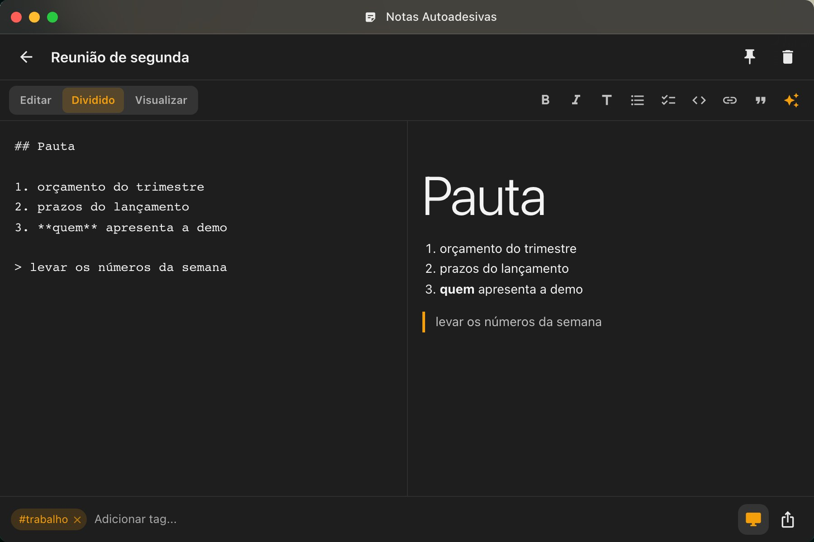
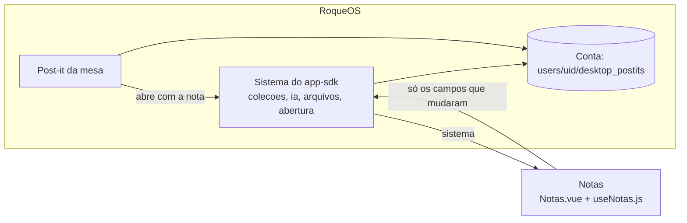

# Notas

_Português | [English](README.md)_

As Notas do [RoqueOS](https://roqueos.com.br): notas em Markdown com edição, visualização e o modo dividido, etiquetas, fixar no topo, busca, lista ou grade, exportar em `.md` ou `.txt`, salvar nos Arquivos e IA sobre o texto. Cada nota é também um **post-it da área de trabalho**: a mesma nota aparece na mesa do RoqueOS, e o que muda num lugar muda no outro. Nos dez idiomas do RoqueOS.

Use de graça em [roqueos.com.br](https://roqueos.com.br), no computador, no celular e na TV.



## Por que existe como repo

As Notas nasceram dentro do RoqueOS, que é fechado. Em 27/09/2026 elas saíram para o próprio repositório na organização [roqueos-apps](https://github.com/roqueos-apps), o primeiro app a guardar dados na conta, usar a IA e ser aberto por outro pedaço do sistema. O RoqueOS as instala por uma tag, como dependência git, e elas falam com ele só pelo [`app-sdk`](https://github.com/roqueos-apps/app-sdk). A tela é feita com o kit [`ui`](https://github.com/roqueos-apps/ui). O mesmo código roda dentro do RoqueOS, sozinho no navegador (`yarn dev`) e no teste.

## Arquitetura



```text
app.json            quem ela é: id permanente (notes), nome e descrição nos dez idiomas,
                    ícone, cor, janela, as capacidades e a coleção que ela abre
i18n/<idioma>.json  os textos da tela, um arquivo por idioma
src/
  index.js          definirApp: cria o app Vue próprio dentro do elemento que o RoqueOS dá
  Notas.vue         a tela: lista, editor, barra de Markdown, ajustes e confirmação
  useNotas.js       o motor: a coleção, o que cada ação grava, a IA, as preferências
  notas.js          o que não depende de tela: ordenar, filtrar, prévia, data, exportação
  markdown.js       o Markdown da pré-visualização, sempre pelo DOMPurify
  textos.js         carrega o JSON do idioma (com ?raw) e traduz uma chave
  notas.scss        o visual
dev/main.js         o yarn dev: as Notas numa janela falsa do RoqueOS
test/               Vitest: o app pelo SDK, a lógica, o Markdown e a troca de idioma
```

Elas falam com o RoqueOS só pelo `sistema` do SDK, e cada capacidade opcional está no `app.json`: `colecoes` (a coleção `notas`, que o RoqueOS guarda na conta da pessoa, no mesmo lugar dos post-its da mesa), `ia` (o painel de IA do RoqueOS dentro do editor; as Notas não veem agente nem chave), `arquivos` (salvar a nota em Documentos, como Markdown) e `abertura` (o post-it que abriu as Notas diz qual nota abrir, `{ nota: 'note_…' }`). Usam também `idioma`, `desempenho`, `avisar` e `armazenamento`.

**Cada ação das Notas manda só o campo que mudou** (`atualizar(id, { pinned })`, nunca a nota inteira): o RoqueOS de antes gravava a nota inteira a cada tecla e, com a nota aberta aqui, desfazia o arraste de um post-it na mesa. O teste `app.spec.js` confere o que cada ação grava, chamada por chamada. O desenho inteiro está na [ARQUITETURA.md](docs/pt-BR/ARQUITETURA.md).

## Como começar

Node 22 ou mais novo (o `.nvmrc` diz 24) e Yarn 1.22.

```bash
yarn install --ignore-scripts
yarn dev          # as Notas numa janela falsa do RoqueOS, numa conta local
yarn verificar    # lint, formato, testes e app check: o mesmo do CI e do pre-push
yarn test         # só os testes
```

Na janela do `yarn dev` as notas ficam no `localStorage`, e continuam depois do F5. `?idioma=ar-AR` abre em árabe, `?leve=1` como o aparelho fraco vê, `?convidado=1` sem conta, e `?abertura={"nota":"note_1"}` como o post-it abre. O painel de IA aparece como um aviso no lugar onde o do RoqueOS abriria, e salvar em Arquivos vira download. O passo a passo está no [COMECAR.md](docs/pt-BR/COMECAR.md).

## Paridade com o app de antes

`paridade.json` é o inventário do que as Notas faziam dentro do RoqueOS e do que aconteceu com cada coisa na saída: `mantida`, `mudou` (com a nota do que mudou) ou `perdida` (só com a decisão escrita de quem decidiu). Cada item cita o teste deste repo que o prova, ou a evidência. O RoqueOS confere o arquivo no pacote instalado antes de aceitar a versão: teste citado que não existe mais, estado de dúvida ou perda sem decisão reprovam. Mudou uma funcionalidade, ou um teste citado ali? Atualize o inventário no mesmo commit.

## Estado do projeto

Versão 0.1.2 (08/10/2026), pinada pelo RoqueOS. 52 funcionalidades inventariadas, 39 mantidas, 13 mudaram, nenhuma perdida. Nada foi medido no iPhone real, e a sincronização entre dois aparelhos reais não foi medida; excluir e o editor não têm desfazer. A lista inteira de limites está na [ARQUITETURA.md](docs/pt-BR/ARQUITETURA.md#9-limites-conhecidos).

## Documentação

Tudo começa pelo [índice da documentação](docs/pt-BR/INDEX.md).

| Documento                                               | O que responde                           |
| ------------------------------------------------------- | ---------------------------------------- |
| [COMECAR.md](docs/pt-BR/COMECAR.md)                     | do clone à primeira nota e ao gate verde |
| [ARQUITETURA.md](docs/pt-BR/ARQUITETURA.md)             | como é por dentro, decisões e limites    |
| [REFERENCIA.md](docs/pt-BR/REFERENCIA.md)               | todo comando, arquivo, campo e chave     |
| [OPERACAO.md](docs/pt-BR/OPERACAO.md)                   | rotina, release, atualizar, desfazer     |
| [QUANDO-QUEBRA.md](docs/pt-BR/QUANDO-QUEBRA.md)         | sintoma, causa, o que fazer              |
| [GLOSSARIO.md](docs/pt-BR/GLOSSARIO.md)                 | os termos                                |
| [INTEGRACOES.md](docs/pt-BR/INTEGRACOES.md)             | o que o RoqueOS e a mesa esperam delas   |
| [MODELO-DE-AMEACAS.md](docs/pt-BR/MODELO-DE-AMEACAS.md) | o que protegem e o que não protegem      |
| [TESTES.md](docs/pt-BR/TESTES.md)                       | o que cada suíte prova                   |
| [DECISOES.md](docs/pt-BR/DECISOES.md)                   | o que não se reabre                      |

## Contribuir

Leia o [CONTRIBUTING.md](docs/pt-BR/CONTRIBUTING.md). Todo commit leva `Signed-off-by` (DCO), e o CI confere. Falha de segurança vai pelo [SECURITY.md](SECURITY.md), nunca por issue pública.

## Créditos e licença

[MIT](LICENSE). Os ícones são do [Material Icons](https://fonts.google.com/icons) (Apache-2.0), pelo kit de interface; veja o [ASSETS.md](ASSETS.md). O Markdown é do [marked](https://github.com/markedjs/marked) (MIT) e a limpeza do [DOMPurify](https://github.com/cure53/DOMPurify) (Apache-2.0 ou MPL-2.0). O nome e a marca RoqueOS são da LEVELHARD e não fazem parte da licença.
