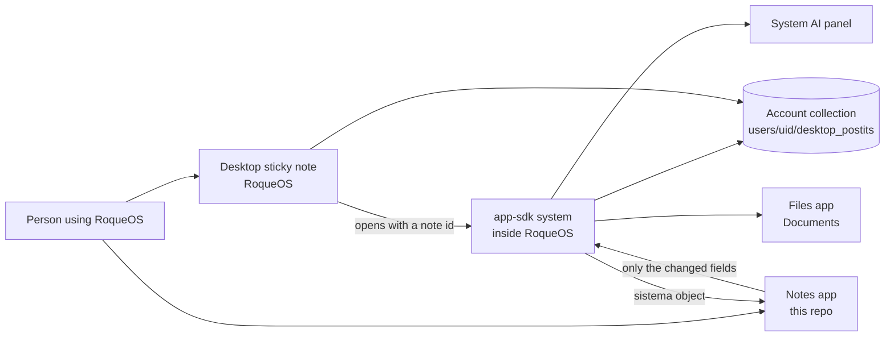
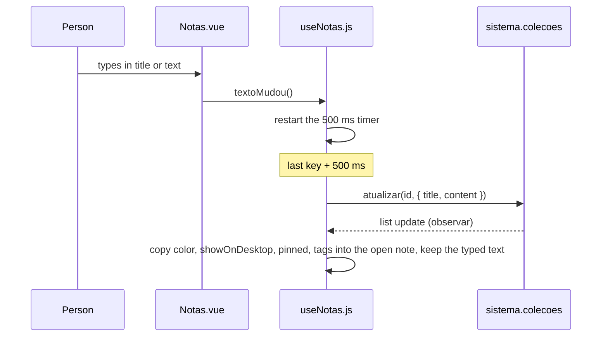
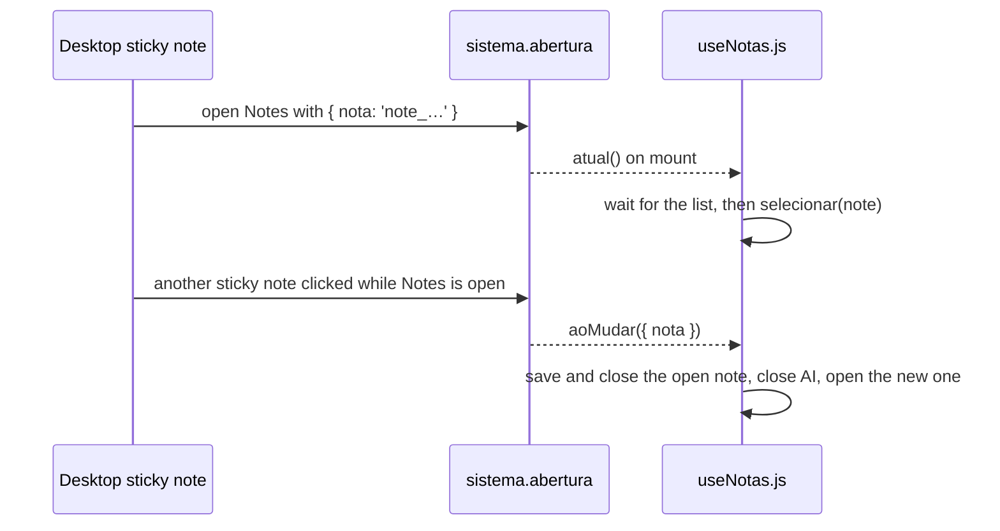
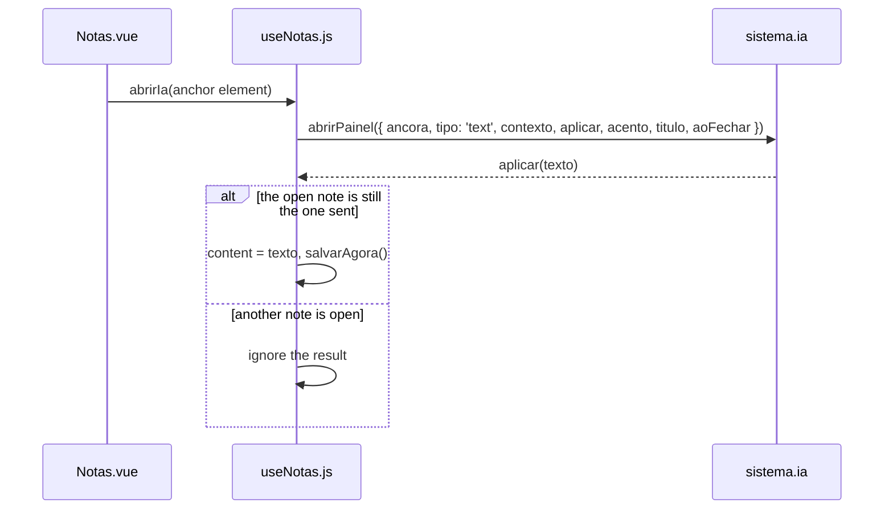

# Architecture

_[Português](pt-BR/ARQUITETURA.md) | English_

> **For whom:** whoever is about to change the Notes app and wants to know how it is put together before touching it.
> **What is here:** the idea, who runs it and what it depends on, the processes, each component with its file, the main flows as sequence diagrams, the data that crosses the boundary with RoqueOS, the security posture, the design decisions and the known limits.
> **Where to go for the rest:** every command and field is in [REFERENCE.md](REFERENCE.md); the contracts other code relies on, in [INTEGRATIONS.md](INTEGRATIONS.md); the decisions that do not get reopened, in [DECISIONS.md](DECISIONS.md).

## Table of contents

1. [The idea in one paragraph](#1-the-idea-in-one-paragraph)
2. [Context](#2-context)
3. [Processes and where they run](#3-processes-and-where-they-run)
4. [Components](#4-components)
5. [Main flows](#5-main-flows)
6. [Data and contracts](#6-data-and-contracts)
7. [Security and secrets](#7-security-and-secrets)
8. [Design decisions](#8-design-decisions)
9. [Known limits](#9-known-limits)
10. [How the diagrams are made](#10-how-the-diagrams-are-made)

## 1. The idea in one paragraph

Notes is a RoqueOS app that lives in its own repository and reaches the system only through the `sistema` object of [`@roqueos-apps/app-sdk`](https://github.com/roqueos-apps/app-sdk). It is a small Vue 3 app: [`src/index.js`](../src/index.js) creates its own Vue instance inside the element RoqueOS hands over, [`src/useNotas.js`](../src/useNotas.js) holds every write and every call to the system, and [`src/Notas.vue`](../src/Notas.vue) only draws. The one thing that makes it more than a Markdown editor is that **every note is also a desktop sticky note**: the same document in the user's account is written by two programs, the RoqueOS desktop (position, size, layer) and this app (title, text, tags, pin, show on desktop). Every rule in this repository that looks strict exists because of that shared document.

## 2. Context



| Depends on                                                                  | What for                                                                                             | What happens when it is missing                                     |
| --------------------------------------------------------------------------- | ---------------------------------------------------------------------------------------------------- | ------------------------------------------------------------------- |
| RoqueOS (closed, `roqueos-front`)                                           | hosts the app, implements the `sistema`, builds it with its own Vite                                 | the app runs only in `yarn dev` and in tests                        |
| [`@roqueos-apps/app-sdk`](https://github.com/roqueos-apps/app-sdk) `v0.2.0` | `definirApp`, the capabilities, the dev system, the fake system, `app check`                         | `yarn install` fails; nothing builds                                |
| [`@roqueos-apps/ui`](https://github.com/roqueos-apps/ui) `v0.6.0`           | the UI primitives (`RosBotao`, `RosFolha`, `RosConfirmar`, `RosIcone`, `RosInterruptor`, `RosVazio`) | the screen does not render                                          |
| `marked` `17.0.1`                                                           | Markdown to HTML in the preview                                                                      | no preview                                                          |
| `dompurify` `3.4.16`                                                        | cleans that HTML before `v-html`                                                                     | the preview must not render; see [THREAT-MODEL.md](THREAT-MODEL.md) |
| `vue` `^3.5.0` (peer)                                                       | the app's own Vue instance                                                                           | RoqueOS provides it; in this repo it is a dev dependency            |

Versions are the ones pinned in [`package.json`](../package.json). `marked` and `dompurify` stay at the exact versions RoqueOS uses ([`CLAUDE.md`](../CLAUDE.md)), because inside RoqueOS yarn deduplicates them with the system's copy.

## 3. Processes and where they run

There is no server and no background job. The same code runs in three places:

| Where          | Who starts it                                                                                      | What the `sistema` is                                                                                                         |
| -------------- | -------------------------------------------------------------------------------------------------- | ----------------------------------------------------------------------------------------------------------------------------- |
| Inside RoqueOS | RoqueOS installs the package by exact tag and calls `mount` when the window opens                  | the real system: account collection, AI panel, Files                                                                          |
| `yarn dev`     | you, with Vite ([`vite.config.js`](../vite.config.js), [`dev/main.js`](../dev/main.js))            | the SDK development system: a fake RoqueOS window, a local account (`uid: 'local'`), `localStorage` for notes and preferences |
| `yarn test`    | Vitest in jsdom ([`vite.config.js`](../vite.config.js), [`test/preparar.js`](../test/preparar.js)) | the SDK fake system, wrapped so each test sees every write                                                                    |

Inside RoqueOS the app is compiled by RoqueOS's own Vite; this repo's `vite.config.js` does not ship (comment at the top of [`vite.config.js`](../vite.config.js)).

## 4. Components

| File                                    | Responsibility                                                                                                                                         | Who depends on it                               |
| --------------------------------------- | ------------------------------------------------------------------------------------------------------------------------------------------------------ | ----------------------------------------------- |
| [`app.json`](../app.json)               | the manifest: permanent `id` (`notes`), names and descriptions in ten languages, icon, color, window size, capabilities, collection                    | RoqueOS's app registry, `app check`, `yarn dev` |
| [`src/index.js`](../src/index.js)       | `definirApp`: loads the language texts, mounts the Vue app, follows language changes, exposes `ativar` and `desmontar`                                 | RoqueOS (`mount`), tests                        |
| [`src/Notas.vue`](../src/Notas.vue)     | the screen: list, search, tag filter, editor, Markdown toolbar, settings sheet, delete confirmation, export menu                                       | `src/index.js`                                  |
| [`src/useNotas.js`](../src/useNotas.js) | the engine: subscribes to the collection, creates, writes one field at a time, deletes, exports, saves to Files, opens the AI panel, keeps preferences | `src/Notas.vue`                                 |
| [`src/notas.js`](../src/notas.js)       | pure logic: sort, filter, card preview, date, tag cleanup, new note fields, export file, toolbar marking, preferences parsing                          | `src/useNotas.js`, `src/Notas.vue`, tests       |
| [`src/markdown.js`](../src/markdown.js) | `markdownSeguro`: own `Marked` instance, then `DOMPurify.sanitize`                                                                                     | `src/useNotas.js` (the preview)                 |
| [`src/textos.js`](../src/textos.js)     | loads `i18n/<language>.json` as raw text and translates a key                                                                                          | `src/index.js`, `src/Notas.vue`                 |
| [`src/notas.scss`](../src/notas.scss)   | the look; theme colors only from the SDK contract variables, app colors as `--notas-*`                                                                 | `src/Notas.vue`                                 |
| [`i18n/`](../i18n/pt-BR.json)           | the screen texts, one JSON per language, pt-BR canonical                                                                                               | `src/textos.js`, `app check`                    |
| [`paridade.json`](../paridade.json)     | the inventory of what Notes did inside RoqueOS and what happened to each item                                                                          | RoqueOS, before it accepts a version            |
| [`dev/main.js`](../dev/main.js)         | `yarn dev`: `montarNaJanelaFalsa` with the manifest                                                                                                    | you                                             |

## 5. Main flows

### 5.1 Typing in a note



The timer is `ESPERA_DO_TEXTO_MS` in [`src/useNotas.js`](../src/useNotas.js). Closing the editor, switching notes and unmounting call `salvarAgora()` so the last half second is not lost. The update from the collection never overwrites the title and text being typed.

### 5.2 Opened from a desktop sticky note



The open note is closed **before** the new request is stored ([`src/useNotas.js`](../src/useNotas.js), comment on `pararAbertura`): saving it notifies the list in the same tick, and the list would otherwise open the new note only for the close below to undo it.

### 5.3 AI over the text



The panel belongs to the system; the app never sees the agent or a key. The anchor is an empty `div` with `display: contents` that Vue never draws into ([`src/Notas.vue`](../src/Notas.vue)).

## 6. Data and contracts

A note as it sits in the collection, after the system adds its date fields (example built from [`test/app.spec.js`](../test/app.spec.js)):

```json
{
  "id": "note_1727400000000",
  "title": "Groceries",
  "content": "- [ ] coffee",
  "color": "#fff59d",
  "x": 100,
  "y": 100,
  "width": 200,
  "height": 200,
  "zIndex": 1000,
  "showOnDesktop": true,
  "pinned": false,
  "tags": ["home"],
  "criadoEm": 1727400000000,
  "atualizadoEm": 1727400000500
}
```

Who writes what:

| Fields                                | Written by                                   | When                                    |
| ------------------------------------- | -------------------------------------------- | --------------------------------------- |
| `x`, `y`, `width`, `height`, `zIndex` | Notes only on create; the desktop afterwards | create                                  |
| `color`                               | Notes on create; the desktop afterwards      | create                                  |
| `title`, `content`                    | Notes                                        | 500 ms after the last key, and on close |
| `pinned`, `tags`, `showOnDesktop`     | Notes                                        | each action writes only its own field   |
| `criadoEm`, `atualizadoEm`            | the system                                   | every create and update                 |

The full field reference, preference format and opening payload are in [REFERENCE.md](REFERENCE.md) and [INTEGRATIONS.md](INTEGRATIONS.md).

## 7. Security and secrets

The repository holds no secret, and the app never sees one: the AI panel, the account and the database belong to the system. The risk that matters is rendering user text as HTML on the RoqueOS origin; the only path is `markdownSeguro` ([`src/markdown.js`](../src/markdown.js)). CI reads no secret ([`.github/workflows/ci.yml`](../.github/workflows/ci.yml)). The full picture is in [THREAT-MODEL.md](THREAT-MODEL.md).

## 8. Design decisions

| Decided                                                                              | Rejected alternative                                            | Why                                                                                                                                                    | When                                                   |
| ------------------------------------------------------------------------------------ | --------------------------------------------------------------- | ------------------------------------------------------------------------------------------------------------------------------------------------------ | ------------------------------------------------------ |
| Each action writes only the field it changed                                         | write the whole note on every key, as the RoqueOS of before did | the whole note carried the old position back and undid a sticky note dragged on the desktop                                                            | 27/09/2026, v0.1.0 ([`CHANGELOG.md`](../CHANGELOG.md)) |
| The editor opens before the system confirms the create                               | wait for the database                                           | without network the confirmation only arrives when it comes back, and the screen froze                                                                 | 27/09/2026, v0.1.0                                     |
| Own `Marked` instance                                                                | `marked.setOptions` global                                      | inside RoqueOS the package is the system's copy; a global option would change Markdown everywhere                                                      | 27/09/2026 ([`src/markdown.js`](../src/markdown.js))   |
| Language JSON loaded as `?raw` plus `JSON.parse`, static map                         | `import` of JSON, or `import(variable)`                         | RoqueOS's build breaks on JSON imports outside `src/i18n/` (measured in the games on 25/09/2026); a variable import bundles all ten languages together | [`src/textos.js`](../src/textos.js)                    |
| Capabilities written twice, in `app.json` and `src/index.js`, with a test tying them | import `app.json` in `src/index.js`                             | the same JSON-import limitation                                                                                                                        | [`src/index.js`](../src/index.js)                      |
| AI result applied only to the note that was sent                                     | apply to whatever note is open                                  | the agent can finish after the person switched notes; the other note's text was replaced                                                               | 28/09/2026, v0.1.1                                     |
| `ui` kit by HTTPS (`github:`)                                                        | `git+ssh`                                                       | GitHub Actions could not install it without a key (measured 29/09: `Permission denied (publickey)`)                                                    | 08/10/2026, v0.1.2                                     |

The ones that are permanent (the `id`, the collection name, the sort values) are in [DECISIONS.md](DECISIONS.md).

## 9. Known limits

- **Delete has no undo.** It asks first and then removes the document ([`src/useNotas.js`](../src/useNotas.js), `excluir`).
- **No undo in the editor either.** The Markdown toolbar rewrites the textarea value, which breaks the native Ctrl+Z; `paridade.json` records this as absent before and after the move.
- **A failed create leaves an editor open on a note that never reached the database**, with the error toast. Not covered by a test ([`paridade.json`](../paridade.json), item "Criar uma nota").
- **No merge of concurrent text edits.** Each save sends this device's whole `{ title, content }`; what the system keeps when two devices write the same note at once was not measured.
- **Not measured on a real iPhone** and **sync between two real devices not measured**; both are stated in the audit of [`paridade.json`](../paridade.json).
- **The link button uses `prompt()`** for the URL ([`src/Notas.vue`](../src/Notas.vue), `inserirLink`).

## 10. How the diagrams are made

Every diagram here is Mermaid inside the Markdown, rendered by GitHub. The source is the text; the Portuguese pair translates the labels. There is no image to regenerate.
