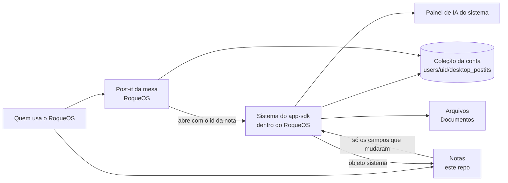
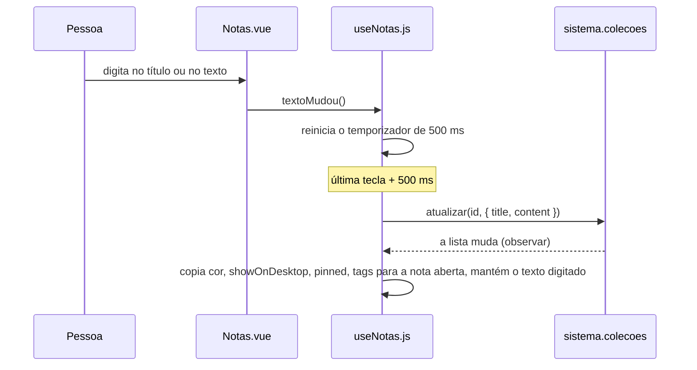
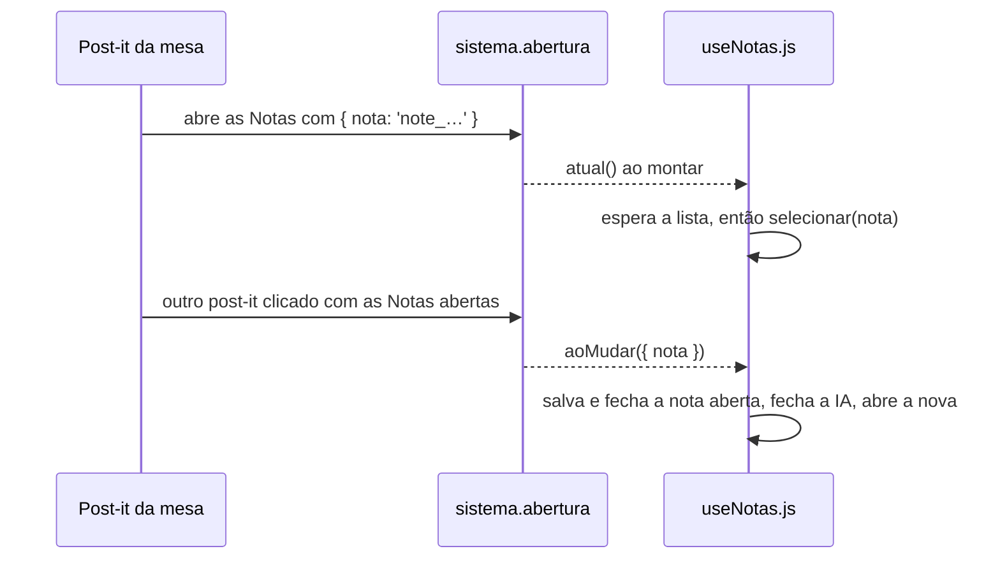
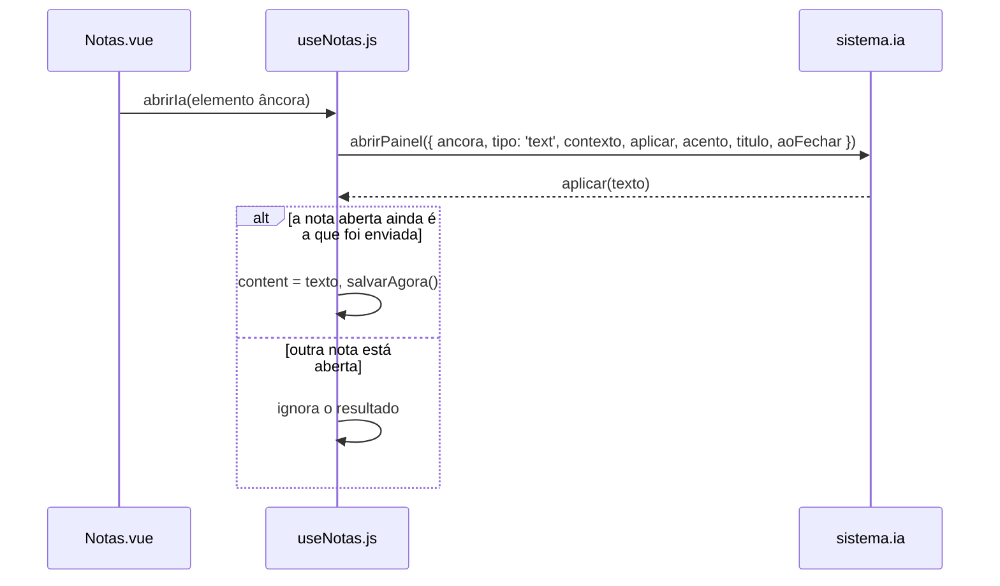

# Arquitetura

_Português | [English](../ARCHITECTURE.md)_

> **Para quem:** quem vai mudar as Notas e quer saber como elas são montadas antes de mexer.
> **O que tem aqui:** a ideia, quem roda e do que depende, os processos, cada componente com o arquivo dele, os fluxos principais em diagrama de sequência, os dados que atravessam a fronteira com o RoqueOS, a segurança, as decisões de design e os limites conhecidos.
> **Onde ir para o resto:** todo comando e campo está na [REFERENCIA.md](REFERENCIA.md); os contratos de que outro código depende, nas [INTEGRACOES.md](INTEGRACOES.md); as decisões que não se reabrem, nas [DECISOES.md](DECISOES.md).

## Sumário

1. [A ideia em um parágrafo](#1-a-ideia-em-um-parágrafo)
2. [Contexto](#2-contexto)
3. [Processos e onde rodam](#3-processos-e-onde-rodam)
4. [Componentes](#4-componentes)
5. [Os fluxos principais](#5-os-fluxos-principais)
6. [Dados e contratos](#6-dados-e-contratos)
7. [Segurança e segredos](#7-segurança-e-segredos)
8. [Decisões de design](#8-decisões-de-design)
9. [Limites conhecidos](#9-limites-conhecidos)
10. [Como os diagramas são feitos](#10-como-os-diagramas-são-feitos)

## 1. A ideia em um parágrafo

As Notas são um app do RoqueOS que mora no próprio repositório e só alcança o sistema pelo objeto `sistema` do [`@roqueos-apps/app-sdk`](https://github.com/roqueos-apps/app-sdk). É um app Vue 3 pequeno: o [`src/index.js`](../../src/index.js) cria uma instância própria do Vue dentro do elemento que o RoqueOS entrega, o [`src/useNotas.js`](../../src/useNotas.js) concentra toda gravação e toda chamada ao sistema, e o [`src/Notas.vue`](../../src/Notas.vue) só desenha. O que faz delas mais que um editor de Markdown é que **cada nota é também um post-it da área de trabalho**: o mesmo documento na conta da pessoa é escrito por dois programas, a mesa do RoqueOS (posição, tamanho, camada) e este app (título, texto, etiquetas, fixar, mostrar na mesa). Toda regra deste repositório que parece rígida existe por causa desse documento compartilhado.

## 2. Contexto



| Depende de                                                                  | Para quê                                                                                                 | O que acontece quando falta                                                               |
| --------------------------------------------------------------------------- | -------------------------------------------------------------------------------------------------------- | ----------------------------------------------------------------------------------------- |
| RoqueOS (fechado, `roqueos-front`)                                          | hospeda o app, implementa o `sistema`, compila com o Vite dele                                           | o app só roda no `yarn dev` e no teste                                                    |
| [`@roqueos-apps/app-sdk`](https://github.com/roqueos-apps/app-sdk) `v0.2.0` | `definirApp`, as capacidades, o sistema de desenvolvimento, o sistema falso, o `app check`               | o `yarn install` falha; nada compila                                                      |
| [`@roqueos-apps/ui`](https://github.com/roqueos-apps/ui) `v0.6.0`           | os primitivos de tela (`RosBotao`, `RosFolha`, `RosConfirmar`, `RosIcone`, `RosInterruptor`, `RosVazio`) | a tela não desenha                                                                        |
| `marked` `17.0.1`                                                           | Markdown para HTML na pré-visualização                                                                   | sem pré-visualização                                                                      |
| `dompurify` `3.4.16`                                                        | limpa esse HTML antes do `v-html`                                                                        | a pré-visualização não pode desenhar; veja o [MODELO-DE-AMEACAS.md](MODELO-DE-AMEACAS.md) |
| `vue` `^3.5.0` (peer)                                                       | a instância própria do Vue                                                                               | o RoqueOS fornece; neste repo é dependência de desenvolvimento                            |

As versões são as pinadas no [`package.json`](../../package.json). `marked` e `dompurify` ficam na versão exata do RoqueOS ([`CLAUDE.md`](../../CLAUDE.md)), porque dentro do RoqueOS o yarn deduplica os dois com a cópia do sistema.

## 3. Processos e onde rodam

Não há servidor nem job de fundo. O mesmo código roda em três lugares:

| Onde              | Quem sobe                                                                                                  | O que é o `sistema`                                                                                                                          |
| ----------------- | ---------------------------------------------------------------------------------------------------------- | -------------------------------------------------------------------------------------------------------------------------------------------- |
| Dentro do RoqueOS | o RoqueOS instala o pacote por tag exata e chama `mount` quando a janela abre                              | o sistema de verdade: coleção da conta, painel de IA, Arquivos                                                                               |
| `yarn dev`        | você, com o Vite ([`vite.config.js`](../../vite.config.js), [`dev/main.js`](../../dev/main.js))            | o sistema de desenvolvimento do SDK: uma janela falsa do RoqueOS, uma conta local (`uid: 'local'`), `localStorage` para notas e preferências |
| `yarn test`       | o Vitest no jsdom ([`vite.config.js`](../../vite.config.js), [`test/preparar.js`](../../test/preparar.js)) | o sistema falso do SDK, embrulhado para cada teste ver toda gravação                                                                         |

Dentro do RoqueOS quem compila o app é o Vite do próprio RoqueOS; o `vite.config.js` deste repo não vai junto (comentário no topo do [`vite.config.js`](../../vite.config.js)).

## 4. Componentes

| Arquivo                                    | Responsabilidade                                                                                                                                                | Quem depende                                               |
| ------------------------------------------ | --------------------------------------------------------------------------------------------------------------------------------------------------------------- | ---------------------------------------------------------- |
| [`app.json`](../../app.json)               | o manifesto: `id` permanente (`notes`), nomes e descrições em dez idiomas, ícone, cor, tamanho da janela, capacidades, coleção                                  | o registro de apps do RoqueOS, o `app check`, o `yarn dev` |
| [`src/index.js`](../../src/index.js)       | `definirApp`: carrega os textos do idioma, monta o app Vue, acompanha a troca de idioma, expõe `ativar` e `desmontar`                                           | o RoqueOS (`mount`), os testes                             |
| [`src/Notas.vue`](../../src/Notas.vue)     | a tela: lista, busca, filtro de etiqueta, editor, barra de Markdown, folha de ajustes, confirmação de exclusão, menu de exportar                                | `src/index.js`                                             |
| [`src/useNotas.js`](../../src/useNotas.js) | o motor: assina a coleção, cria, grava um campo por vez, exclui, exporta, salva em Arquivos, abre o painel de IA, guarda as preferências                        | `src/Notas.vue`                                            |
| [`src/notas.js`](../../src/notas.js)       | lógica pura: ordenar, filtrar, prévia do cartão, data, limpar etiqueta, campos da nota nova, arquivo de exportação, marcação da barra, leitura das preferências | `src/useNotas.js`, `src/Notas.vue`, testes                 |
| [`src/markdown.js`](../../src/markdown.js) | `markdownSeguro`: instância própria do `Marked`, depois `DOMPurify.sanitize`                                                                                    | `src/useNotas.js` (a pré-visualização)                     |
| [`src/textos.js`](../../src/textos.js)     | carrega `i18n/<idioma>.json` como texto e traduz uma chave                                                                                                      | `src/index.js`, `src/Notas.vue`                            |
| [`src/notas.scss`](../../src/notas.scss)   | o visual; cores do tema só pelas variáveis do contrato do SDK, cores do app como `--notas-*`                                                                    | `src/Notas.vue`                                            |
| [`i18n/`](../../i18n/pt-BR.json)           | os textos da tela, um JSON por idioma, pt-BR canônico                                                                                                           | `src/textos.js`, `app check`                               |
| [`paridade.json`](../../paridade.json)     | o inventário do que as Notas faziam dentro do RoqueOS e do que aconteceu com cada item                                                                          | o RoqueOS, antes de aceitar a versão                       |
| [`dev/main.js`](../../dev/main.js)         | o `yarn dev`: `montarNaJanelaFalsa` com o manifesto                                                                                                             | você                                                       |

## 5. Os fluxos principais

### 5.1 Digitar numa nota



O temporizador é o `ESPERA_DO_TEXTO_MS` do [`src/useNotas.js`](../../src/useNotas.js). Fechar o editor, trocar de nota e desmontar chamam `salvarAgora()`, para o último meio segundo não se perder. A atualização que vem da coleção nunca sobrescreve o título e o texto que estão sendo digitados.

### 5.2 Aberta por um post-it da mesa



A nota aberta é fechada **antes** de o pedido novo ser guardado ([`src/useNotas.js`](../../src/useNotas.js), comentário do `pararAbertura`): gravar o texto dela avisa a lista na mesma volta, e a lista abriria a nota nova só para o fechamento logo abaixo desfazer.

### 5.3 IA sobre o texto



O painel é do sistema; o app nunca vê o agente nem uma chave. A âncora é um `div` vazio com `display: contents`, em que o Vue nunca desenha nada ([`src/Notas.vue`](../../src/Notas.vue)).

## 6. Dados e contratos

Uma nota como fica na coleção, depois que o sistema acrescenta as datas (exemplo montado a partir do [`test/app.spec.js`](../../test/app.spec.js)):

```json
{
  "id": "note_1727400000000",
  "title": "Groceries",
  "content": "- [ ] coffee",
  "color": "#fff59d",
  "x": 100,
  "y": 100,
  "width": 200,
  "height": 200,
  "zIndex": 1000,
  "showOnDesktop": true,
  "pinned": false,
  "tags": ["home"],
  "criadoEm": 1727400000000,
  "atualizadoEm": 1727400000500
}
```

Quem grava o quê:

| Campos                                | Quem grava                            | Quando                                     |
| ------------------------------------- | ------------------------------------- | ------------------------------------------ |
| `x`, `y`, `width`, `height`, `zIndex` | as Notas só na criação; a mesa depois | criar                                      |
| `color`                               | as Notas na criação; a mesa depois    | criar                                      |
| `title`, `content`                    | as Notas                              | 500 ms depois da última tecla, e ao fechar |
| `pinned`, `tags`, `showOnDesktop`     | as Notas                              | cada ação grava só o seu campo             |
| `criadoEm`, `atualizadoEm`            | o sistema                             | toda criação e toda atualização            |

A referência completa dos campos, o formato das preferências e o pedido de abertura estão na [REFERENCIA.md](REFERENCIA.md) e nas [INTEGRACOES.md](INTEGRACOES.md).

## 7. Segurança e segredos

O repositório não guarda segredo, e o app nunca vê um: o painel de IA, a conta e o banco são do sistema. O risco que importa é mostrar texto da pessoa como HTML na origem do RoqueOS; o único caminho é o `markdownSeguro` ([`src/markdown.js`](../../src/markdown.js)). O CI não lê segredo ([`.github/workflows/ci.yml`](../../.github/workflows/ci.yml)). O quadro inteiro está no [MODELO-DE-AMEACAS.md](MODELO-DE-AMEACAS.md).

## 8. Decisões de design

| Decidido                                                                                   | Alternativa recusada                                        | Por quê                                                                                                                                                 | Quando                                                    |
| ------------------------------------------------------------------------------------------ | ----------------------------------------------------------- | ------------------------------------------------------------------------------------------------------------------------------------------------------- | --------------------------------------------------------- |
| Cada ação grava só o campo que mudou                                                       | gravar a nota inteira a cada tecla, como o RoqueOS de antes | a nota inteira levava a posição velha de volta e desfazia o post-it arrastado na mesa                                                                   | 27/09/2026, v0.1.0 ([`CHANGELOG.md`](../../CHANGELOG.md)) |
| O editor abre antes de o sistema confirmar a criação                                       | esperar o banco                                             | sem rede a confirmação só chega quando ela volta, e a tela travava                                                                                      | 27/09/2026, v0.1.0                                        |
| Instância própria do `Marked`                                                              | `marked.setOptions` global                                  | dentro do RoqueOS o pacote é a cópia do sistema; uma opção global mudaria o Markdown de todo lugar                                                      | 27/09/2026 ([`src/markdown.js`](../../src/markdown.js))   |
| JSON de idioma carregado com `?raw` e `JSON.parse`, mapa estático                          | `import` de JSON, ou `import(variável)`                     | o build do RoqueOS quebra com import de JSON fora de `src/i18n/` (medido nos jogos em 25/09/2026); o import por variável empacota os dez idiomas juntos | [`src/textos.js`](../../src/textos.js)                    |
| Capacidades escritas duas vezes, no `app.json` e no `src/index.js`, com um teste amarrando | importar o `app.json` no `src/index.js`                     | a mesma limitação do import de JSON                                                                                                                     | [`src/index.js`](../../src/index.js)                      |
| Resultado da IA aplicado só na nota que foi enviada                                        | aplicar na nota que estiver aberta                          | o agente pode terminar depois de a pessoa trocar de nota; o texto da outra nota era trocado                                                             | 28/09/2026, v0.1.1                                        |
| Kit `ui` por HTTPS (`github:`)                                                             | `git+ssh`                                                   | o GitHub Actions não instalava sem chave (medido em 29/09: `Permission denied (publickey)`)                                                             | 08/10/2026, v0.1.2                                        |

As permanentes (o `id`, o nome da coleção, os valores de ordem) estão nas [DECISOES.md](DECISOES.md).

## 9. Limites conhecidos

- **Excluir não tem desfazer.** Pergunta antes e então apaga o documento ([`src/useNotas.js`](../../src/useNotas.js), `excluir`).
- **O editor também não tem desfazer.** A barra de Markdown reescreve o valor do campo, o que quebra o Ctrl+Z nativo; o `paridade.json` registra isso como ausente antes e depois da saída.
- **Uma criação que falha deixa o editor aberto numa nota que nunca chegou ao banco**, com o aviso de erro. Sem teste ([`paridade.json`](../../paridade.json), item "Criar uma nota").
- **Não há fusão de edições simultâneas do texto.** Cada gravação manda o `{ title, content }` inteiro deste aparelho; o que o sistema guarda quando dois aparelhos gravam a mesma nota ao mesmo tempo não foi medido.
- **Nada medido no iPhone real** e **sincronização entre dois aparelhos reais não medida**; os dois estão ditos na auditoria do [`paridade.json`](../../paridade.json).
- **O botão de link usa `prompt()`** para o endereço ([`src/Notas.vue`](../../src/Notas.vue), `inserirLink`).

## 10. Como os diagramas são feitos

Todo diagrama aqui é Mermaid dentro do Markdown, desenhado pelo GitHub. A fonte é o texto; este par em português traduz os rótulos do principal em inglês. Não há imagem para regenerar.
